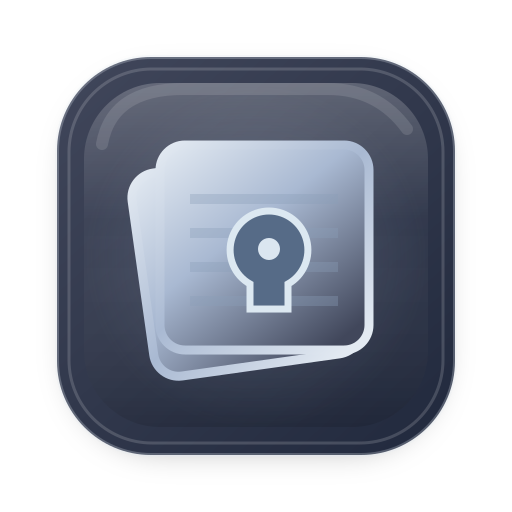
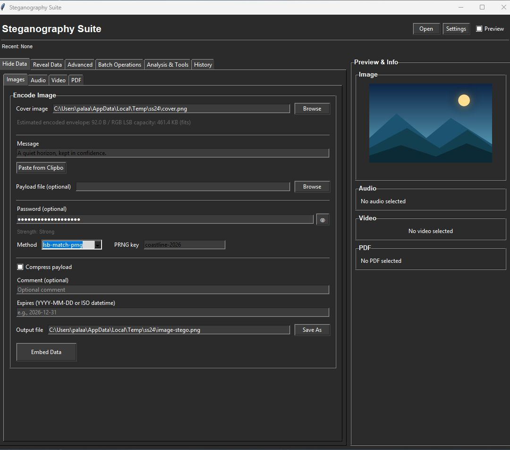

# Steganography Tool



[Icon, wordmark, and brand assets](assets/brand/README.md)


[](https://github.com/palaashatri/steganography-tk/actions/workflows/ci-cd.yml)

This project provides image and video-frame LSB steganography plus a desktop GUI. The `audio-*`, `video-encode`/`video-decode`, and `pdf-*` commands store payloads in ordinary container metadata; those commands do **not** conceal that data and should not be described as steganography.

## What each mode does

### Image LSB mode

The `encode` and `decode` commands store bytes in image pixel least-significant bits. Encoded image output is PNG so those bits survive saving. JPEG and GIF are not supported as output formats. Optional encryption uses AES-GCM with a fresh salt and nonce and PBKDF2-SHA256 (200,000 iterations). New `lsb-prng` and `lsb-match-prng` images use a version 3 envelope and an incremental keyed permutation; the decoder still supports version 1 and 2 images. LSB and version 3 PRNG decoding read only the declared envelope; legacy version 1 and 2 PRNG decoding reconstructs the historical full-channel permutation to preserve compatibility, with a safety limit of 33,554,432 channel positions. Larger legacy PRNG carriers are refused; version 3 PRNG images do not use that legacy allocation path. When compression is enabled, plaintext plus metadata is limited to 64 MiB, and decoding enforces the same expansion limit.

### Video-frame LSB mode

`video-frame-encode` and `video-frame-decode` store bytes in the selected frame's pixel least-significant bits. Write to a lossless MKV output so the embedded bits survive encoding; lossy video output is not supported. Source audio streams are copied to the output. Unlike `video-encode`/`video-decode`, this mode changes frame pixels rather than adding visible metadata.

### Visible metadata modes

Metadata is visible to tag and document inspection tools. Encryption protects the payload contents when a password is supplied, but the tag, comment, or PDF field remains present and detectable. Each metadata mode accepts a serialized envelope of at most **1,000,000 bytes**. The limit is checked before the carrier output is written; base64 storage adds overhead to the final container size.

| Command | Supported carrier extensions | Metadata location |
| --- | --- | --- |
| `audio-encode` / `audio-decode` | `.mp3`, `.mp4`, `.m4a`, `.m4b`, `.m4p`, `.m4v`, `.mov`, `.wav`, `.flac`, `.ogg`, `.opus`, `.aac` | MP3 APIC frame, MP4-family atom, or audio metadata tag |
| `video-encode` / `video-decode` | `.mp4`, `.m4a`, `.m4b`, `.m4p`, `.m4v`, `.mov`, `.mkv`, `.avi`, `.webm` | MP4-family atom or visible container comment |
| `pdf-encode` / `pdf-decode` | `.pdf` | PDF document metadata field |

MP3 and MP4-family metadata modes also accept image attachments; MP4-family video metadata supports `--image` and `--mp3` attachments. Attachments are stored as their original file bytes in new envelopes. Existing version 1 pixel-based image attachments remain decodable where their dimensions are present.

## Installation

```bash
git clone https://github.com/palaashatri/steganography-tk.git
cd steganography-tk
python -m pip install -r requirements.txt
```

Run the GUI with:

```bash
python gui/main.py
```

On Unix-like systems, `./run.sh` creates the local environment and runs a temporary PNG round-trip demo. Pass CLI arguments to use the script as a convenience launcher.

## GUI screenshots

The [complete GUI screenshot gallery](docs/screenshots/README.md) covers the carrier modes, analysis, batch operations, shared tools, settings, help, and successful workflows.



## CLI examples

Image LSB embedding writes a PNG carrier:

```bash
python app.py encode --image cover.png --out stego.png --in-file secret.bin
python app.py decode --image stego.png --out recovered.bin
```

For encryption, avoid putting passwords in `--password`: command arguments can appear in process listings and shell history. `--credentials-stdin` reads a JSON object from standard input. This example prompts for the password without placing it in the command line:

```bash
python -c 'import getpass, json, sys; json.dump({"password": getpass.getpass("Password: ")}, sys.stdout)' | python app.py encode --image cover.png --out stego.png --in-file secret.bin --credentials-stdin
```

The following commands store **visible metadata**. Anyone who lists the carrier tags or document properties can see that a payload was stored.

```bash
# Audio tags or metadata
python app.py audio-encode --audio input.flac --out output.flac --in-file secret.bin
python app.py audio-decode --audio output.flac --out recovered.bin

# Video container comment or metadata
python app.py video-encode --video input.mkv --out output.mkv --message "Visible metadata payload"
python app.py video-decode --video output.mkv --out recovered.bin

# PDF document metadata
python app.py pdf-encode --pdf input.pdf --out output.pdf --in-file secret.bin
python app.py pdf-decode --pdf output.pdf --out recovered.bin
```

Video-frame LSB mode embeds in one chosen frame and writes a lossless MKV:

```bash
python app.py video-frame-encode --video input.mkv --out stego.mkv --frame 0 --in-file secret.bin
python app.py video-frame-decode --video stego.mkv --frame 0 --out recovered.bin
```

For MP3 or MP4-family carriers, `audio-encode` accepts `--image` to store an image file. For MP4-family carriers, `video-encode` accepts `--image` or `--mp3`. Those options preserve the attached file bytes inside the envelope; they do not embed image pixels in a video or audio stream.

Use `python app.py --help` or a command's `--help` for all options. Metadata encode help states the visibility and 1,000,000-byte envelope limit.

## Verification

Run tests locally with:

```bash
python -m pip install pytest pytest-cov
pytest -q
```

Audio and video test fixtures use the FFmpeg binary bundled by `imageio-ffmpeg`; you do not need a separate system FFmpeg installation to run the tests.

Run the Docker test image with:

```bash
docker build --target test -t stego-test .
docker run --rm stego-test
```

The [CI workflow](https://github.com/palaashatri/steganography-tk/actions/workflows/ci-cd.yml) runs source tests on Linux, macOS, and Windows, and builds and runs the Docker test image. The Docker verification commands above use the same test suite. [Windows and macOS downloadable packages are attached to published GitHub releases](https://github.com/palaashatri/steganography-tk/releases); this repository does not publish a release as part of normal branch verification.

## Project structure

```text
steganography-tk/
├── app.py              # CLI interface
├── stego/              # Core, image, audio, video, PDF, and utility operations
├── gui/                # Tkinter interface
├── tests/              # Automated tests
├── Dockerfile          # Containerized verification and build stages
└── .github/workflows/  # CI and release packaging
```

## License

MIT License. See [LICENSE](LICENSE).
