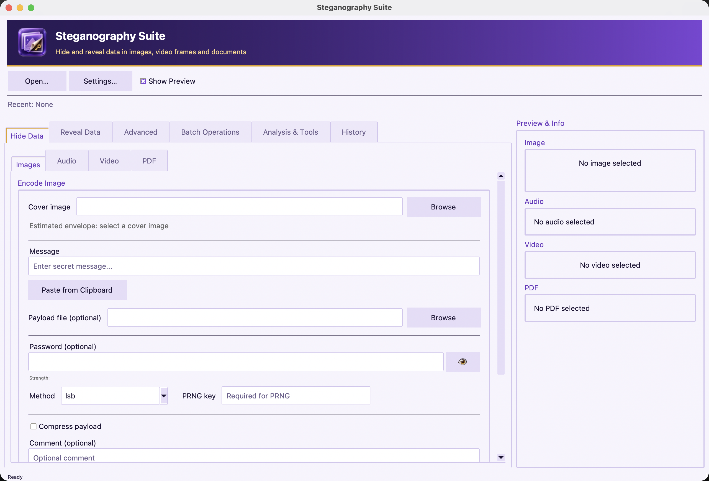
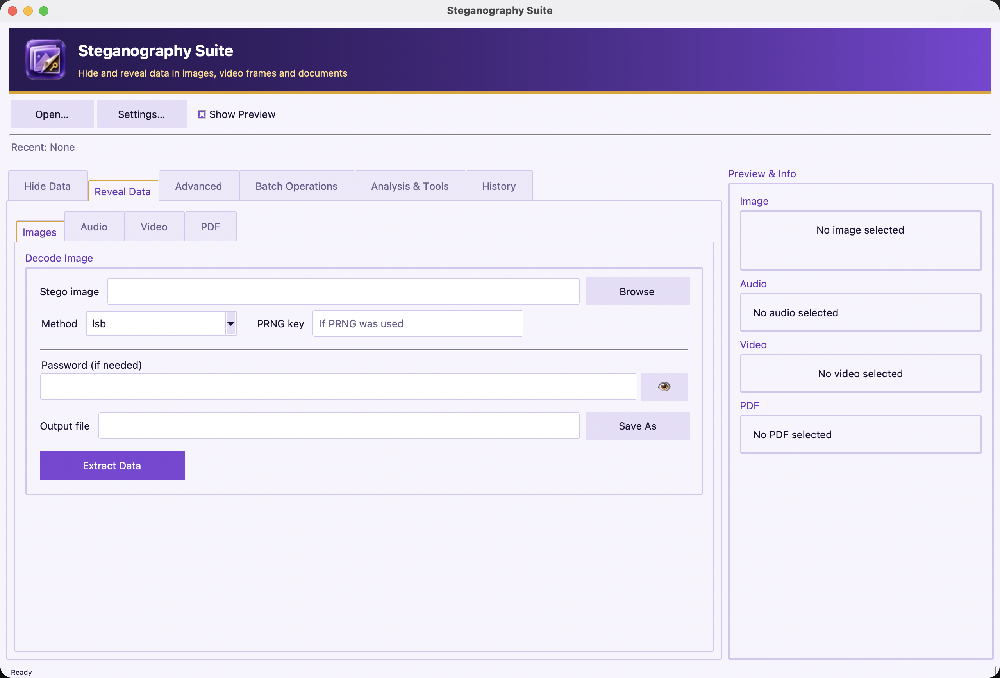

# GUI Screenshots

Captured on macOS (dark appearance by default; Settings → Appearance offers System, Dark and Light) with `python scripts/capture_screenshots.py`.
The window uses the brand palette from [`assets/brand`](../../assets/brand): a violet gradient banner with the
logo and a gold rule, violet/gold themed controls, and a standard macOS menu bar
(app, File, Edit, View, Window, Help).

## Menu bar

## Tabs

### Hide Data

### Reveal Data

### Advanced

### Batch Operations

### Analysis & Tools

### History

## Light appearance

